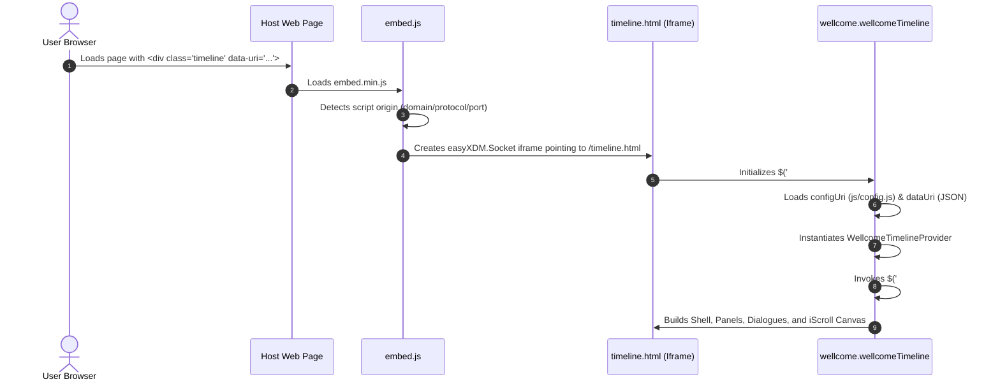
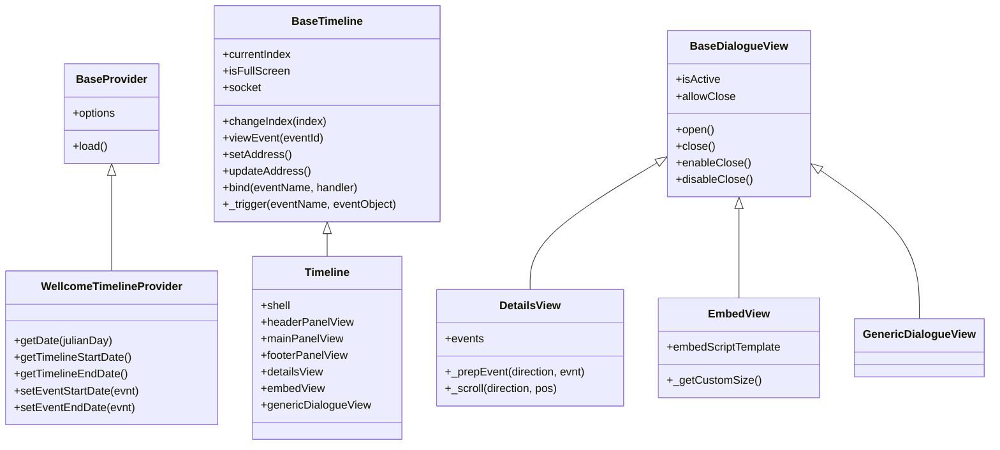

# AGENTS.md — Wellcome Timeline Developer & Agent Guide

> **Target Audience:** Autonomous AI coding agents, maintainers, and developers interacting with, extending, or refactoring the **Wellcome Timeline** application codebase.

---

## 1. Executive Summary & Application Overview

The **Wellcome Timeline** is a client-side interactive timeline component developed by the Wellcome Library (now Wellcome Collection). It visualizes historical events over centuries, decades, and years, smoothly scaling and expanding as users zoom and pan across time.

A live production implementation can be observed in the Wellcome Library Medical Officer of Health (MOH) reports:
- **Live Example**: [Wellcome Library MOH Timeline](https://wellcomelibrary.org/moh/timeline/)
- **Live Example Host Embed Markup**:
  ```html
  <div class="timelineContainer" style="height: 900px">
      <div id="timeline" class="timeline" data-uri="/timelines/moh.json" style="width:100%; height:900px"></div>
      <script type="text/javascript" src="/plugins/timeline/embed.min.js"></script>
  </div>
  ```

### Primary Characteristics
- **Embeddable via Iframe & easyXDM**: Designed to be dropped into any host CMS or external site via an embed snippet without CSS or JS collisions.
- **Calendar-Independent Julian Day Foundation**: Historical dates spanning arbitrary eras (including BCE/ancient dates) are processed using astronomical Julian Day numbers converted into `moment.js` objects.
- **Density-Adaptive Canvas**: Uses a dynamic collision detection and multi-level vertical event stacking algorithm. As the user zooms in, horizontal space expands and more event cards seamlessly fade in.
- **Dual-Level Navigation**: Event cards float above tick bars on an [iScroll](https://github.com/cubiq/iscroll) canvas, while aggregated tick-dots represent events on the time axis even when zoomed out.
- **Deep Linking**: Synchronizes selected events with parent window URL fragments (e.g., `#16121`).

---

## 2. Technology Stack & Key Dependencies

| Component | Library / Version | Role & Notes |
| :--- | :--- | :--- |
| **DOM & UI Foundation** | [jQuery 1.7.2](https://github.com/jquery/jquery) | Loaded via Google CDN or fallback in [embed.js](file:///Users/matt.mcgrattan/code/timeline/src/js/embed.js) and [timeline.html](file:///Users/matt.mcgrattan/code/timeline/src/timeline.html). |
| **Widget Architecture** | [jQuery UI 1.10.1](https://github.com/jquery/jquery-ui) | Provides `$.widget()` factory for component creation, subclassing, and event triggering. |
| **Date Calculations** | [moment.js](https://github.com/timrwood/moment) | High-level date math, duration formatting, and boundary calculations. |
| **Calendar Math** | [julianDateConverter.js](file:///Users/matt.mcgrattan/code/timeline/src/js/julianDateConverter.js) | Algorithm (Press et al.) converting Julian Day numbers $\leftrightarrow$ Gregorian calendar dates. |
| **Touch / Scroll Canvas** | [iScroll v4](file:///Users/matt.mcgrattan/code/timeline/src/js/libs/iscroll.js) | Accelerated horizontal kinetic touch and drag scrolling in `#scroll`. |
| **Cross-Domain Iframe** | [easyXDM 2.4.17](file:///Users/matt.mcgrattan/code/timeline/src/js/libs/easyXDM.min.js) | PostMessage and Flash/SWF fallback for secure iframe $\leftrightarrow$ parent communication. |
| **Deep Link State** | [jQuery Address 1.5](file:///Users/matt.mcgrattan/code/timeline/src/js/libs/jquery.address-1.5.min.js) | Manages URL hash deep linking and browser history navigation. |
| **Polyfills** | [json2.js](file:///Users/matt.mcgrattan/code/timeline/src/js/libs/json2.min.js) | Legacy JSON serializer polyfill for old browser environments. |

---

## 3. Directory Layout & File Organization

```
timeline/
├── README.md                      # Original project overview and build notes
├── MIT-LICENSE.txt                # Open source license
├── build.ps1                      # Windows PowerShell build script (Closure Compiler)
├── timeline.sublime-project       # Sublime Text project configuration
├── build/                         # Compiled and minified production bundles
│   ├── embed.min.js               # Embed bootstrap script (host page entry point)
│   ├── wellcomeTimeline.js        # Concatenated unminified application bundle
│   └── wellcomeTimeline.min.js    # Minified application bundle
└── src/                           # Source application directory
    ├── AGENTS.md                  # This document
    ├── index.html                 # Local development testing harness for embed.js
    ├── timeline.html              # Core iframe runtime application host
    ├── sample_data.js             # Sample timeline dataset (Genetics, 124 events)
    ├── sample_data_2.js           # Extended dataset with rich links (141 events, UTF-8 BOM)
    ├── css/
    │   ├── styles.css             # Main UI theme, layouts, sprites, and animations
    │   └── ie.css                 # Internet Explorer 8 and below styling overrides
    ├── img/                       # UI sprites, arrows, backgrounds, and loading assets
    └── js/
        ├── config.js              # Localization strings and runtime settings
        ├── utils.js               # Helper math, DOM, string, and query string functions
        ├── julianDateConverter.js # Julian Day arithmetic
        ├── jquery.plugins.js      # jQuery plugins (repeatButton, idleTimer, ellipsis, etc.)
        ├── baseProvider.js        # Abstract data provider base class
        ├── wellcomeTimelineProvider.js # Concrete Julian Day provider for Wellcome data
        ├── baseTimeline.js        # Base widget: events, socket, resize, state management
        ├── timeline.js            # Main timeline widget coordinator and subview linker
        ├── shell.js               # Layout shell container: manages DOM panels and dialogs
        ├── headerPanelView.js     # Top title bar and Zoom In / Zoom Out controls
        ├── mainPanelView.js       # Core timeline engine: ticks, event layout, zoom, scrolling
        ├── footerPanelView.js     # Bottom bar: Fullscreen toggle and Embed dialog trigger
        ├── baseDialogueView.js    # Base overlay modal dialog widget
        ├── detailsView.js         # Event inspection modal dialog with Previous/Next slides
        ├── embedView.js           # Embed code generator modal dialog
        ├── genericDialogueView.js # Generic alert/confirmation dialog widget
        ├── embed.js               # Standalone host-page embedder script (creates iframe)
        └── libs/                  # Third-party vendor dependencies
            ├── easyXDM.min.js
            ├── easyxdm.swf
            ├── iscroll.js
            ├── iscroll.min.js
            ├── jquery.address-1.5.min.js
            ├── json2.min.js
            └── moment.min.js
```

---

## 4. Architectural Patterns & Data Flow

### 4.1. The Host Embedding Pipeline



1. **Host Element**: The host page contains `<div class="timeline" data-uri="..." data-eventid="..."></div>` and includes [embed.min.js](file:///Users/matt.mcgrattan/code/timeline/src/js/embed.js).
2. **Dynamic Script Discovery**: [embed.js](file:///Users/matt.mcgrattan/code/timeline/src/js/embed.js) inspects `<script>` tags to identify its own absolute hosting URL, deriving protocol, hostname, and port.
3. **Iframe Injection**: Creates an `easyXDM.Socket` containing an iframe pointing to `timeline.html` with query parameters:
   - `isHomeDomain`: Boolean indicating if host domain matches timeline domain.
   - `isOnlyInstance`: Boolean indicating if single timeline on the page.
   - `dataUri`: Target timeline JSON data source.
   - `eventId`: Optional initial event ID to display.
   - `embedScriptUri`: Full URI to `embed.min.js`.
   - `url`: Parent document URL.

### 4.2. Widget Hierarchy and Component Structure

The application adopts the **jQuery UI Widget Factory** pattern (`$.widget(name, [basePrototype], prototype)`):



- **Global Registry Reference**: During initialization of [`timeline_baseTimeline`](file:///Users/matt.mcgrattan/code/timeline/src/js/baseTimeline.js#L14), the widget sets `$.wellcome.timeline = self;`. All views and helper functions access timeline state via `$.wellcome.timeline`.

---

## 5. Event Bus & Inter-Component Communication

The system communicates internally via custom jQuery events triggered on `self.element` (the root container).

### 5.1. Internal Application Events

| Constant Name | Event String | Fired By | Purpose / Handlers |
| :--- | :--- | :--- | :--- |
| `RESIZE` | `"onResize"` | Window resize / Shell | Triggers re-computation of widths, layouts, and dialog centering. |
| `TOGGLE_FULLSCREEN` | `"onToggleFullScreen"` | Footer panel / Socket | Toggles full-viewport fixed position mode via easyXDM socket to parent frame. |
| `ZOOM_IN` / `ZOOM_OUT` | `"onZoomIn"` / `"onZoomOut"` | Header panel | Initiates step zoom in or out on main panel canvas. |
| `START_ZOOM` / `FINISH_ZOOM` | `"onStartZoom"` / `"onFinishZoom"` | Main panel | Disables zoom/prev/next buttons during animation, refreshes state upon completion. |
| `START_SCROLL` / `FINISH_SCROLL` | `"onStartScroll"` / `"onFinishScroll"` | Main panel / Details | Synchronizes horizontal slide transitions between detail cards. |
| `SCROLL_STEP` | `"onScrollStep"` | Main panel | Transmits kinetic scroll step `{ direction, pos }` to synchronize detail slides. |
| `START_NAVIGATING` / `FINISH_NAVIGATING` | `"onStartNavigating"` / `"onFinishNavigating"` | Main panel | Locks button interactions while auto-navigating/scrolling to a target event. |
| `START_INDEX_CHANGE` | `"onStartIndexChange"` | `changeIndex()` | Notifies panels that an event has been selected; updates URL hash. |
| `FINISH_INDEX_CHANGE` | `"onFinishIndexChange"` | Main panel | Signals that event selection navigation animation has settled. |
| `SHOW_EVENT_DETAILS_DIALOGUE` | `"onShowEventDetailsDialogue"` | `changeIndex()` | Opens the event details overlay modal for the selected event. |
| `HIDE_EVENT_DETAILS_DIALOGUE` | `"onHideEventDetailsDialogue"` | Details view close | Deselects event and closes details overlay modal. |
| `SHOW_EMBED_DIALOGUE` / `HIDE_EMBED_DIALOGUE` | `"onShowEmbedDialogue"` / `...` | Footer panel / Embed view | Shows or hides the iframe embed code generation dialog and background overlay mask. |
| `CLOSE_ACTIVE_DIALOGUE` | `"onCloseActiveDialogue"` | Shell overlay mask / ESC | Closes whatever dialog is currently open. |
| `ESCAPE` / `RETURN` | `"onEscape"` / `"onReturn"` | Document keyup | Triggers modal dismissal or keyboard selection. |
| `REFRESHED` | `"onRefreshed"` | Main panel | Indicates ticks, event visibility, and stacks have completed rendering. |

### 5.2. Parent-Iframe Socket Events (`easyXDM`)

The `easyXDM.Socket` connects [timeline.html](file:///Users/matt.mcgrattan/code/timeline/src/timeline.html) to [embed.js](file:///Users/matt.mcgrattan/code/timeline/src/js/embed.js) in the parent page:

- **`onToggleFullScreen`**: Toggles `position: fixed; z-index: 9999; width: 100%; height: 100%` on host page iframe element, disabling parent page scrolling.
- **`onRedirect`**: Instructs host window to navigate to a target URL (`window.location.replace`).
- **`onRefresh`**: Instructs host page to reload (`window.location.reload`).
- **`onTrackEvent` / `onTrackVariable`**: Sends Google Analytics event data (`trackEvent`, `trackVariable`) up to parent window if present.

---

## 6. Core Algorithms in `mainPanelView.js`

[mainPanelView.js](file:///Users/matt.mcgrattan/code/timeline/src/js/mainPanelView.js) is the engine of the timeline. Agents working on zoom, event layout, or rendering must understand these algorithms:

### 6.1. Dynamic Resolution Bands & Ticks
1. Calculates chronological span between `startDate` and `endDate`.
2. Evaluates total spans:
   - Days: `endDate.diff(startDate, 'days')`
   - Years: `endDate.diff(startDate, 'years')`
   - Decades: Calculated via `_getDecade()`
   - Centuries: Calculated via `_getCentury()`
3. Creates tick arrays for **Years**, **Decades**, and **Centuries**.
4. During render (`_drawTicks`):
   - At lower zoom levels (content width small), century ticks or decade ticks are displayed.
   - At higher zoom levels, individual year ticks are displayed.
   - Tick elements contain dates and small dot indicators (`.tickEvent`) showing where events exist along the timeline ruler.

### 6.2. Event Stacking & Collision Detection
To prevent event cards from overlapping:
- **`eventStackSize`**: Set to `3` in [wellcomeTimelineProvider.js](file:///Users/matt.mcgrattan/code/timeline/src/js/wellcomeTimelineProvider.js).
- Events are distributed round-robin across `3` vertical stack levels (0, 1, 2).
- When drawing events (`_updateVisibleEvents` and `_updateStackLevelVisibleEvents`):
  - In each stack level, event horizontal positions are calculated.
  - If two adjacent events on the same stack level would overlap (distance between positions $<$ card width), only higher-priority / earlier events remain visible (`evnt.isVisible = true`), while the colliding event is hidden (`evnt.isVisible = false`).
  - As user zooms in, pixel distance between normalized date coordinates increases, collision disappears, and hidden events dynamically appear.

### 6.3. Zooming Dynamics
- **Zoom Factor**: Zooming scales `.content` width exponentially (`zoomFactor = 3`).
- **Smooth Animation**: Uses jQuery `.animate()` with `easeInOutCubic` easing to expand `#scroll .content` width. During the animation step callback:
  - If an event is selected, it maintains centering on that event's target scroll position.
  - If no event is selected, it preserves the relative normalized scroll percentage.
  - Re-invokes `_redraw(true, true)` on each step to update positions smoothly.
- **`_zoomUntilVisible(evnt)`**: If a user deep-links to or selects an event that is currently clipped/hidden due to low zoom density, this recursive function automatically steps through zoom-ins until `evnt.isVisible` is satisfied, then scrolls into view.

---

## 7. Data Contracts & JSON Schema

Timeline data is loaded asynchronously from a JSON endpoint specified in the `data-uri` attribute.

### 7.1. Root Timeline Object Schema

```json
{
  "Title": "The history of genetics: from Darwin to present day",
  "FeatureImagePath": "http://wellcomelibrary.org/.../images/27491",
  "Body": "<p>Introductory HTML description displayed at index -1...</p>",
  "InitialCaption": "In 1859 the story of genetics began...",
  "IsOpenEnded": false,
  "EarliestJulianDay": 2400046,
  "StartDateDisplay": "1859",
  "LastJulianDay": 2456434,
  "EndDateDisplay": "Present Day",
  "BackgroundEvents": [ ... ],
  "Events": [ ... ]
}
```

### 7.2. Event Object Schema

```json
{
  "EventId": 6389,
  "Title": "Charles Darwin publishes 'On the Origin of Species'",
  "Body": "<p>Evolution had been a topic of vigorous debate...</p>",
  "Priority": 1,
  "Year": "1859",
  "StartDisplayYear": "1859",
  "StartDisplay": "1859",
  "EndDisplayYear": null,
  "EndDisplay": null,
  "JulianDayStart": 2400046,
  "JulianDayEnd": -9223372036854775808,
  "ThumbnailPath": "http://wellcomelibrary.org/.../1859-Darwin-100.jpg",
  "FeatureImagePath": "http://wellcomelibrary.org/.../1859-Darwin-250",
  "PromoImagePath": "http://wellcomelibrary.org/.../1859-Darwin-250",
  "LinkText": "Read 'On the Origin of Species'",
  "LinkTarget": "http://wellcomelibrary.org/player/b1802922x#0/5/...",
  "ImageCredit": "Test image credit (c) Wellcome Library",
  "UsedBy": [ "/21461/fomg/fomg-timeline/" ]
}
```

#### Important Data Schema Notes
1. **End Date Sentinel Value**: If an event has no end date (a point-in-time event), `JulianDayEnd` is set to `-9223372036854775808` (the minimum 64-bit integer value). [`WellcomeTimelineProvider.setEventEndDate`](file:///Users/matt.mcgrattan/code/timeline/src/js/wellcomeTimelineProvider.js#L55-L61) tests `if (evnt.JulianDayEnd < 0)` to default `endDate = startDate`.
2. **Present Day Extension**: If the timeline end date extends to or past the current year, `mainPanelView.js` synthesizes a special "Present Day" event at index `Events.length`.
3. **Introductory Event (Index -1)**: When viewing event index `-1`, the [detailsView.js](file:///Users/matt.mcgrattan/code/timeline/src/js/detailsView.js) displays the root dataset's `Title`, `FeatureImagePath`, and `Body`.
4. **UTF-8 BOM Warning**: Certain datasets (such as `sample_data_2.js`) originate from Windows systems and contain a UTF-8 Byte Order Mark (`\ufeff`). When reading, generating, or processing data files, tools must tolerate or strip the UTF-8 BOM.

---

## 8. Build Process, Compilation & Scripts

### 8.1. Production Bundle Build

The production build combines and minifies JavaScript files using Google Closure Compiler.

- **PowerShell Script**: [build.ps1](file:///Users/matt.mcgrattan/code/timeline/build.ps1) (in repository root).
- **Outputs**:
  - `build/embed.min.js`: Minified version of [src/js/embed.js](file:///Users/matt.mcgrattan/code/timeline/src/js/embed.js).
  - `build/wellcomeTimeline.js`: Concatenated unminified bundle of the timeline scripts.
  - `build/wellcomeTimeline.min.js`: Minified bundle of the timeline scripts.

### 8.2. Script Concatenation Order (Strict Dependency Sequence)

When bundling or loading unminified scripts in [timeline.html](file:///Users/matt.mcgrattan/code/timeline/src/timeline.html), the following sequence **must be preserved**:

1. `js/julianDateConverter.js`
2. `js/jquery.plugins.js`
3. `js/utils.js`
4. `js/baseProvider.js`
5. `js/wellcomeTimelineProvider.js` *(extends `BaseProvider`)*
6. `js/baseTimeline.js`
7. `js/wellcomeTimeline.js` *(entry widget: loads config & data)*
8. `js/timeline.js` *(extends `timeline_baseTimeline`)*
9. `js/shell.js`
10. `js/headerPanelView.js`
11. `js/mainPanelView.js`
12. `js/footerPanelView.js`
13. `js/baseDialogueView.js`
14. `js/genericDialogueView.js` *(extends `baseDialogueView`)*
15. `js/embedView.js` *(extends `baseDialogueView`)*
16. `js/detailsView.js` *(extends `baseDialogueView`)*

---

## 9. Development Workflow & Local Testing

### 9.1. Running a Local Server (Port 8003)

Because `easyXDM`, iframes, and AJAX (`$.getJSON`) rely on HTTP headers and origin checking, the application **cannot be tested using the `file://` protocol**.
- [`embed.js`](file:///Users/matt.mcgrattan/code/timeline/src/js/embed.js#L48-L55) derives its `basePath` relative to `scriptUri`, so it works both at the domain root (`/index.html`) and under any subpath (`/src/index.html` or GitHub Pages `/<repo>/src/index.html`).
- [`src/`](file:///Users/matt.mcgrattan/code/timeline/src) is self-contained: [`timeline.html`](file:///Users/matt.mcgrattan/code/timeline/src/timeline.html) loads the unminified `js/*.js` scripts directly, and `src/build/` also contains a copy of `build/`.

Run a local HTTP server from `/Users/matt.mcgrattan/code/timeline`:

```bash
# Serve src/ directly at http://localhost:8003/index.html
python3 -m http.server 8003 --directory src

# Or serve the repo root at http://localhost:8003/src/index.html
python3 -m http.server 8003
```

### 9.2. Accessing the Application & Sample Datasets

- **Embed Test Harness (Default: `sample_data_2.js`)**: `http://localhost:8003/index.html`
- **Deep-Linked Event (Visible at Initial Zoom)**: `http://localhost:8003/index.html#6389` *(1859 — Charles Darwin)*
- **Deep-Linked Event (Triggers `_zoomUntilVisible` Auto-Zoom)**: `http://localhost:8003/index.html#15452` *(1871 — Friedrich Miescher)*
- **Switching Sample Datasets**: In [`src/index.html`](file:///Users/matt.mcgrattan/code/timeline/src/index.html#L14), change the `data-uri` attribute on `<div class="timeline" data-uri="sample_data_2.js">` to `"sample_data.js"`. Note that the query string on `<script src="js/embed.js?dataUri='sample_data.js'">` in `index.html` is ignored by [`embed.js`](file:///Users/matt.mcgrattan/code/timeline/src/js/embed.js#L69), which reads `$(element).attr('data-uri')`.
- **Important (`timeline.html` Cannot Be Opened Standalone)**: Always load via `index.html` (the host page). Opening `timeline.html` directly without a parent `easyXDM` frame throws `Uncaught TypeError: Cannot read properties of undefined (reading 'replace')` in `easyXDM.min.js` because [`baseTimeline.js`](file:///Users/matt.mcgrattan/code/timeline/src/js/baseTimeline.js#L50) initializes `new easyXDM.Socket(...)` expecting `xdm_e`, `xdm_c`, and `xdm_p` query parameters from the parent window.

### 9.3. Switching Between Minified and Unminified Debugging

#### In [src/timeline.html](file:///Users/matt.mcgrattan/code/timeline/src/timeline.html):
- **To test minified bundle** (default):
  ```html
  <script type="text/javascript" src="build/wellcomeTimeline.min.js"></script>
  ```
- **To test individual source files directly (No build step or `/build` mapping required)**:
  Comment out `build/wellcomeTimeline.min.js` and uncomment the 16 individual script tags listed in the block comment inside [src/timeline.html](file:///Users/matt.mcgrattan/code/timeline/src/timeline.html#L32-L48).

#### In [src/index.html](file:///Users/matt.mcgrattan/code/timeline/src/index.html):
- Switch `<script type="text/javascript" src="js/embed.js"></script>` or `build/embed.min.js`.

---

## 10. Agent Guidelines & Code Modification Rules

When making changes to this repository, AI agents must abide by the following technical constraints:

1. **Maintain Prototype & Widget Inheritance Integrity**:
   - `WellcomeTimelineProvider` inherits from `BaseProvider` via `Child.prototype = new Parent(); Child.prototype.constructor = Child;`. Do not introduce ES6 classes without a transpilation pipeline.
   - jQuery UI widgets inherit via `$.widget("ns.childWidget", $.ns.parentWidget, { ... })`. Ensure parent methods are called via `$.ns.parentWidget.prototype.methodName.call(self, ...)`.
2. **Preserve Global Namespace Expectations**:
   - `$.wellcome.timeline` is expected to be accessible across views.
   - Do not pollute `window` beyond existing intentional helpers in [utils.js](file:///Users/matt.mcgrattan/code/timeline/src/js/utils.js) (`window.log`).
3. **Respect iScroll Lifecycle**:
   - Any dynamic changes to `#scroll` or `.content` element sizes must be followed by `self.scroll.refresh()` to recalculate scroll boundaries and touch listeners.
4. **Coordinate Transitions via Event Bus**:
   - Do not trigger direct DOM manipulations between separate panel widgets. Instead, fire the designated event on `self._trigger(...)` or invoke standard methods on `$.wellcome.timeline`.
5. **Preserve Compatibility with Historic Browsers**:
   - Do not use modern ES6+ features (`const`, `let`, arrow functions, template literals, `async/await`, `fetch`, Promises) in runtime code unless a build step transpiles them, as the project was authored for standard ECMAScript 5 environments.
6. **Double-Check Date Edge Cases**:
   - Julian day math does not recognize Year 0.
   - Gregorian transition occurred between October 4, 1582 and October 15, 1582. Dates in that range are flagged invalid by [julianDateConverter.js](file:///Users/matt.mcgrattan/code/timeline/src/js/julianDateConverter.js).
   - Negative Julian day end (`< 0`) must always be treated as a single point-in-time event.
