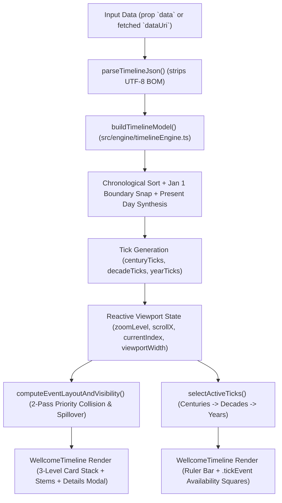

# AGENTS.md — Wellcome Timeline Developer & Agent Guide (v2.0 React + TypeScript)

> **Target Audience:** Autonomous AI coding agents, maintainers, and developers interacting with, extending, or deploying the **Wellcome Timeline** codebase.

---

## 1. Executive Summary & Application Overview

The **Wellcome Timeline** is an interactive client-side historical timeline component originally created by the Wellcome Library (Wellcome Collection) and rewritten from the ground up in **React 18, TypeScript, and Vite**. All legacy runtime dependencies (`jQuery 1.7.2`, `jQuery UI 1.10.1`, `iScroll v4`, `easyXDM`, `jquery.address`, `moment.js`, and `json2.js`) have been eliminated while preserving the original data contracts, astronomical Julian Day math, dual-level navigation UX, and deep-linking behavior.

The original ES5/jQuery codebase is preserved for historical reference in [`legacy/`](file:///Users/matt.mcgrattan/code/timeline/legacy).

### Key Capabilities & Enhancements
- **Zero Legacy Dependencies & Scoped Styling:** Built with React 18, TypeScript, and CSS Modules ([`WellcomeTimeline.module.css`](file:///Users/matt.mcgrattan/code/timeline/src/components/WellcomeTimeline.module.css)) so the component can be mounted directly on any host page without global CSS/JS collisions or `easyXDM` iframes.
- **Monet's Letters Visual Theme:** Restyled to match the typography (`Cormorant Garamond Variable` and `Work Sans Variable`) and warm archival color palette (`#fefbf4` paper, `#f6f3ec` section wash, `#ebe4db` stone panels, `#d8cfc3` borders, and `#19599a` / `#124574` Monet blues) of [Monet's Letters](https://monet-letters-dev.ch.digirati.io/en/people/141), while keeping the original layout geometry and UX intact.
- **Astronomical Julian Day Foundation:** Processes historical and ancient BCE/CE dates via a strict TypeScript port of the Press et al. algorithm in [`julianDateConverter.ts`](file:///Users/matt.mcgrattan/code/timeline/src/utils/julianDateConverter.ts) combined with `date-fns`.
- **Two-Pass Priority Collision Engine & Spillover:** Distributes events across a 3-level vertical stack (`eventStackSize = 3`), resolving horizontal overlaps in strict priority order (eliminating legacy "zombie suppression") and spilling colliding cards in dense decades into open adjacent rows.
- **Smooth Wheel, Pointer & Kinetic Scrolling:** Uses [`normalize-wheel-es`](https://www.npmjs.com/package/normalize-wheel-es) for cross-browser wheel/trackpad normalization alongside native React Pointer Events and `requestAnimationFrame` inertia decay (`0.92` friction), gating CSS transitions so interactive scrolling runs at immediate 1:1 frame rates.
- **Dual Build Targets:**
  1. **Static Site (`docs/`):** Self-contained GitHub Pages build (`base: './'`) defaulting to [`monet_letters.json`](file:///Users/matt.mcgrattan/code/timeline/src/monet_letters.json) (397 Claude Monet correspondence events with DLCS IIIF square thumbnails).
  2. **Embeddable Library (`dist/`):** Tree-shakeable ESM (`dist/wellcome-timeline.js`) and UMD (`dist/wellcome-timeline.umd.cjs`) bundles with an automatic `.timeline` DOM mounter ([`src/lib.ts`](file:///Users/matt.mcgrattan/code/timeline/src/lib.ts)).

---

## 2. Technology Stack & Key Dependencies

| Layer | Package / Module | Role & Notes |
| :--- | :--- | :--- |
| **UI Runtime** | `react` / `react-dom` (`^18.3.1`) | Declarative component rendering, state hooks, and DOM lifecycle. |
| **Language** | `typescript` (`^5.4.5`) | Strict static typing across data schemas, Julian Day math, and engine state. |
| **Build & Bundler** | `vite` (`^5.3.1`) + `@vitejs/plugin-react` | Serves local dev on port `8003`, builds static GitHub Pages output to `docs/`, and builds ESM/UMD library bundles to `dist/`. |
| **Calendar Math** | [`src/utils/julianDateConverter.ts`](file:///Users/matt.mcgrattan/code/timeline/src/utils/julianDateConverter.ts) | Pure TypeScript port of Press et al. Julian Day $\leftrightarrow$ Gregorian calendar conversion, Year 0 rejection, and Oct 1582 Gregorian transition handling. |
| **Date Arithmetic** | `date-fns` (`^3.6.0`) | Lightweight date boundary calculation (`addYears`, `differenceInDays`). |
| **Scroll Normalization** | `normalize-wheel-es` (`^1.2.0`) | Normalizes `WheelEvent` (`DOM_DELTA_PIXEL`, `DOM_DELTA_LINE`, `DOM_DELTA_PAGE`) across Chrome, Safari, Firefox, trackpads, and physical scroll wheels. |
| **Styling & Fonts** | [`WellcomeTimeline.module.css`](file:///Users/matt.mcgrattan/code/timeline/src/components/WellcomeTimeline.module.css) | Scoped CSS Modules with bundled `Cormorant Garamond Variable` and `Work Sans Variable` `.woff2` fonts and `--color-monet-*` custom properties. |
| **Unit Testing** | `vitest` (`^1.6.0`) + `jsdom` | Unit and integration test runner verifying calendar edge cases, BOM parsing, chronological sorting, collision rules, and auto-zoom. |

---

## 3. Directory Layout & File Organization

```text
timeline/
├── index.html                                  # Vite app entry HTML
├── package.json                                # Scripts and dependencies
├── tsconfig.json                               # TypeScript compiler configuration (strict mode)
├── vite.config.ts                              # Dual-mode Vite config (docs/ static site + dist/ library)
├── .eslintrc.cjs                               # ESLint configuration
├── .prettierrc                                 # Prettier formatting rules
├── .github/
│   └── workflows/
│       └── deploy-pages.yml                    # GitHub Actions workflow for GitHub Pages deployment
├── public/                                     # Static assets copied verbatim to docs/ on build
│   ├── fonts/                                  # Local Cormorant Garamond & Work Sans variable .woff2 files
│   ├── monet_letters.json                      # 397-event Monet Letters dataset with IIIF thumbnails
│   ├── sample_data_2.js                        # 141-event History of Genetics dataset (UTF-8 BOM)
│   └── sample_data.js                          # 124-event History of Genetics dataset
├── src/
│   ├── AGENTS.md                               # This developer and agent architecture guide
│   ├── main.tsx                                # Standalone app entry point (loads monet_letters.json by default)
│   ├── lib.ts                                  # Library entry point (exports components, engine, and DOM mounter)
│   ├── monet_letters.json                      # Bundled default dataset (Claude Monet Correspondence)
│   ├── sample_data_2.js                        # Legacy dataset with UTF-8 BOM (used by unit tests & ?dataUri=)
│   ├── sample_data.js                          # Legacy genetics dataset
│   ├── assets/
│   │   └── fonts/                              # Variable .woff2 fonts resolved relatively by Vite CSS bundler
│   ├── types/
│   │   └── timeline.ts                         # TypeScript interfaces for JSON schemas, computed events, and options
│   ├── utils/
│   │   ├── julianDateConverter.ts              # Press et al. Julian Day math, UTF-8 BOM JSON parser, helpers
│   │   └── __tests__/
│   │       └── julianDateConverter.test.ts     # 12 Vitest unit tests covering math, sorting, and engine logic
│   ├── engine/
│   │   └── timelineEngine.ts                   # Pure layout engine: ticks, 2-pass collision, spillover, auto-zoom
│   └── components/
│       ├── WellcomeTimeline.tsx                # Main interactive timeline React component
│       └── WellcomeTimeline.module.css         # Scoped Monet's Letters theme, 3-level stack, ruler, and modals
├── docs/                                       # Built static site for GitHub Pages (generated by npm run build)
├── dist/                                       # Built ESM & UMD library bundles (generated by npm run build:lib)
└── legacy/                                     # Archived original ES5 / jQuery / iScroll / easyXDM codebase
```

---

## 4. Architecture & Data Flow

### 4.1. Component & Engine Data Flow



### 4.2. Standalone App vs. Host Page Embedding

1. **Standalone App ([`src/main.tsx`](file:///Users/matt.mcgrattan/code/timeline/src/main.tsx)):**
   - Parses [`src/monet_letters.json`](file:///Users/matt.mcgrattan/code/timeline/src/monet_letters.json) at startup for instant zero-latency rendering.
   - Checks `window.location.search` for `?dataUri=<path>`: if provided (e.g., `?dataUri=sample_data_2.js`), fetches and parses that dataset instead.
2. **React Component Import ([`src/lib.ts`](file:///Users/matt.mcgrattan/code/timeline/src/lib.ts)):**
   ```tsx
   import { WellcomeTimeline } from 'wellcome-timeline';
   import 'wellcome-timeline/dist/style.css';

   <WellcomeTimeline dataUri="monet_letters.json" eventId={43515} />
   ```
3. **Drop-In Host HTML Snippet ([`mountAllWellcomeTimelines`](file:///Users/matt.mcgrattan/code/timeline/src/lib.ts#L50-L76)):**
   When loaded via a `<script>` tag (`wellcome-timeline.umd.cjs`), the library automatically scans the DOM for `.timeline` elements and mounts a React root inside each:
   ```html
   <div class="timeline" data-uri="monet_letters.json" data-eventid="43515" style="width:100%; height:700px;"></div>
   <link rel="stylesheet" href="./style.css" />
   <script src="./wellcome-timeline.umd.cjs"></script>
   ```

---

## 5. Core Mathematical & Layout Engine (`src/engine/timelineEngine.ts`)

[`src/engine/timelineEngine.ts`](file:///Users/matt.mcgrattan/code/timeline/src/engine/timelineEngine.ts) is a pure, side-effect-free TypeScript module that computes all timeline geometry, tick bands, collision states, and zoom coordinates.

### 5.1. Calendar Boundary Alignment (`makeBoundaryDate` & `buildTimelineModel`)
- Computes initial date bounds from `data.EarliestJulianDay` and `data.LastJulianDay` using [`julianDayToDate`](file:///Users/matt.mcgrattan/code/timeline/src/utils/julianDateConverter.ts#L162-L176).
- Snaps `startDate` to **January 1** (`monthIndex = 0, day = 1`, fixing the legacy `new Date(year, 1, 1)` February 1 offset bug) and sets `endDate` to the exact exclusive upper bound (`addYears(..., 1 | 10 | 100)`):
  - Span `< 10` years: snaps to January 1 of `startYear` through `endYear + 1`.
  - Span `10–99` years: snaps to decade boundaries (e.g., `1860-01-01` to `1900-01-01`).
  - Span `>= 100` years: snaps to century boundaries (e.g., `1800-01-01` to `2100-01-01`).
- Normalizes every event's horizontal coordinate to `position` $\in [0, 1]$ via `differenceInDays(evStart, startDate) / days`.

### 5.2. Chronological Event Sorting & Present Day Synthesis
- Source JSON files (such as `sample_data_2.js`) occasionally list events out of chronological order. [`buildTimelineModel`](file:///Users/matt.mcgrattan/code/timeline/src/engine/timelineEngine.ts#L132-L144) sorts all input events by:
  1. `JulianDayStart` ascending
  2. `Priority` ascending (lower number = higher importance)
  3. Original array index ascending
- If `endDate.getFullYear() >= nowDate.getFullYear()`, synthesizes a `"Present Day"` marker event (`isPresent: true, Priority: 1`) at the end of the array.
- Assigns each event an initial primary `stackLevel = index % 3` (`0`, `1`, or `2`).

### 5.3. Dynamic Resolution Tick Bands (`selectActiveTicks` & `getMaxWidth`)
- Pre-computes three tick arrays in [`buildTimelineModel`](file:///Users/matt.mcgrattan/code/timeline/src/engine/timelineEngine.ts#L204-L237): `centuryTicks`, `decadeTicks`, and `yearTicks`, associating each tick with the non-present events falling within its year range.
- [`selectActiveTicks(model, availableWidth, options)`](file:///Users/matt.mcgrattan/code/timeline/src/engine/timelineEngine.ts#L317-L332) selects the active ruler band based on pixel density:
  1. **`centuries`:** When `model.centuries > 0` and `availableWidth / model.centuries <= 500px` (`maxCenturyIntervalWidth`).
  2. **`decades`:** When `model.decades > 0` and `availableWidth / model.decades <= 2000px` (`maxDecadeIntervalWidth`).
  3. **`years`:** Whenever decade width exceeds `2000px` (so each individual year tick is `> 200px` wide), regardless of whether the timeline spans `< 100` or `>= 100` years.
- [`getMaxWidth(model, options)`](file:///Users/matt.mcgrattan/code/timeline/src/engine/timelineEngine.ts#L265-L273) returns `Math.max(maxDecadeIntervalWidth * decades, maxYearIntervalWidth * years)` (`500px * years`), ensuring multi-century timelines can always zoom in to year-level resolution.

### 5.4. Two-Pass Priority Collision Engine & Spillover (`computeEventLayoutAndVisibility`)
To prevent cards (`207px` wide with thumbnail, `137px` `.min` without thumbnail, plus a `10px` minimum horizontal margin) from overlapping on the 3-level vertical stack (`top = 0px, 101px, 202px`):

1. **Candidate Priority Ordering (Eliminating "Zombie Suppression"):**
   - The legacy left-to-right sweep had a flaw where a medium-priority event `A` could suppress an earlier lower-priority event `B`, and then `A` itself would be suppressed by a later high-priority event `C`—leaving an unnecessary blank gap where `B` could have fit.
   - [`computeEventLayoutAndVisibility`](file:///Users/matt.mcgrattan/code/timeline/src/engine/timelineEngine.ts#L345-L413) sorts candidates by `(forcedVisibleIndex first, Priority ascending, index ascending)` before placement. Higher-priority events claim their horizontal intervals `[leftPos, leftPos + width + 10]` first, so defeated lower-priority events never suppress neighbors.
2. **Pass 1 — Primary Stack Placement:**
   - Each candidate attempts to fit on its primary round-robin `stackLevel` (`index % 3`), preserving the visual 3-tier staircase rhythm when space permits.
3. **Pass 2 — Dense-Cluster Spillover:**
   - Any candidate that collided on its primary row checks the remaining rows `(stackLevel + 1) % 3` and `(stackLevel + 2) % 3`. If another row has an unobstructed `[leftPos, leftPos + width + 10]` window, the event spills over into that row (`stackLevel`, `top`, and stem `lineHeight` are updated dynamically).
4. **Max-Zoom Collision Safety & Forced Selection Visibility:**
   - Unlike the legacy engine (which bypassed collision detection at max zoom and caused same-year cards to pile unreadably on top of one another), collision detection remains active at **all** zoom levels.
   - Passing `forcedVisibleIndex` (`currentIndex` in [`WellcomeTimeline.tsx`](file:///Users/matt.mcgrattan/code/timeline/src/components/WellcomeTimeline.tsx#L130-L139)) guarantees that the user's actively selected or deep-linked event is placed first and is always visible on the canvas.

### 5.5. Exponential Zooming & Recursive `_zoomUntilVisible` (`computeZoomUntilVisible`)
- Content width scales exponentially by powers of `zoomFactor = 3`:
  $$\text{contentWidth} = \text{baseWidth} \times 3^{\text{zoomLevel}}$$
- When a user clicks a greyed-out `.tickEvent` square, clicks `Previous`/`Next`, or loads a URL hash `#<EventId>`, [`computeZoomUntilVisible`](file:///Users/matt.mcgrattan/code/timeline/src/engine/timelineEngine.ts#L428-L473) increments `zoomLevel` until the target event is naturally visible without collision (or until `canZoom(1, ...)` reaches `maxWidth`, at which point `forcedVisibleIndex` guarantees visibility) and computes the centered horizontal offset via [`getEventScrollPosition`](file:///Users/matt.mcgrattan/code/timeline/src/engine/timelineEngine.ts#L419-L426).

---

## 6. Scrolling, Gestures & Visual Theme (`src/components/WellcomeTimeline.tsx`)

### 6.1. Wheel Normalization & Immediate vs. Animated Transitions
- **Wheel & Trackpad Input ([`onWheel`](file:///Users/matt.mcgrattan/code/timeline/src/components/WellcomeTimeline.tsx#L387-L413)):**
  - Uses `normalizeWheel(e.nativeEvent)` from `normalize-wheel-es` to convert browser-specific wheel deltas (`pixelX`, `pixelY`) into uniform pixel offsets.
  - Detects when the pointer is over a scrollable `.tickEvents` container in a dense tick (`scrollHeight > clientHeight`) and allows native vertical scrolling inside that tick grid when `|deltaY| > |deltaX|`.
- **Pointer Drag & Kinetic Inertia ([`onPointerDown`](file:///Users/matt.mcgrattan/code/timeline/src/components/WellcomeTimeline.tsx#L329-L385)):**
  - Tracks pointer velocity during drag and launches a `requestAnimationFrame` decay loop (`v *= 0.92`) on `pointerup`.
- **Transition Gating ([`triggerSmoothTransition`](file:///Users/matt.mcgrattan/code/timeline/src/components/WellcomeTimeline.tsx#L128-L137)):**
  - `.scrollContent` defines a `0.45s cubic-bezier(0.65, 0, 0.35, 1)` transition on `width` and `transform`.
  - That CSS transition is active **only** when `isAnimating` is `true` (for 460ms after a programmatic Zoom In/Out or event selection jump). During wheel scrolling, pointer dragging, and kinetic coasting, `.scrollContentImmediate` (`transition: none !important`) is applied so `translate3d` updates at native 60–120fps without fighting the bezier curve.

### 6.2. Monet's Letters Theme Tokens ([`WellcomeTimeline.module.css`](file:///Users/matt.mcgrattan/code/timeline/src/components/WellcomeTimeline.module.css))
- **Fonts:**
  - `--font-serif`: `'Cormorant Garamond Variable', 'Cormorant Garamond', ui-serif, Georgia, serif`
  - `--font-sans`: `'Work Sans Variable', 'Work Sans', ui-sans-serif, system-ui, sans-serif`
- **Color Palette:**
  - `--color-monet-page`: `#fefbf4` (warm ivory paper background)
  - `--color-monet-section`: `#f6f3ec` (soft cream header, footer, and canvas wash)
  - `--color-monet-panel`: `#ebe4db` (stone thumbnail frames and zoom pill buttons)
  - `--color-monet-card`: `#ffffff` (event cards and details modal surface)
  - `--color-monet-border`: `#d8cfc3` (card borders and hidden `.tickEvent` squares)
  - `--color-monet-link`: `#19599a` (Monet royal blue headings, card left accent, and tick year labels)
  - `--color-monet-deep-blue`: `#124574` (selected/highlighted event cards, available `.tickEvent` squares, and `Prev`/`Next`/`Close` buttons)
  - `--color-monet-soft-blue`: `#83a3c4` (vertical event stem lines)
  - `--color-monet-text`: `#1c1c1e` (primary charcoal ink)
  - `--color-monet-text-secondary`: `#606060` (secondary labels)

---

## 7. Data Contracts & Datasets

### 7.1. Included Datasets
- [`src/monet_letters.json`](file:///Users/matt.mcgrattan/code/timeline/src/monet_letters.json) & [`public/monet_letters.json`](file:///Users/matt.mcgrattan/code/timeline/public/monet_letters.json): **Default dataset.** 397 letters from the Claude Monet Correspondence collection (`1864–1926`), populated with square IIIF thumbnails (`.../full/!100,100/0/default.jpg`) and feature images (`.../full/!250,250/0/default.jpg`) from the DLCS Presentation API (`https://presentation-api.dlc.services/38/monet-letters/howard-letter-collection`).
- [`src/sample_data_2.js`](file:///Users/matt.mcgrattan/code/timeline/src/sample_data_2.js) & [`public/sample_data_2.js`](file:///Users/matt.mcgrattan/code/timeline/public/sample_data_2.js): 141-event Wellcome Library *History of Genetics* dataset (`1859–2012`), prefixed with a UTF-8 BOM (`\uFEFF`). Accessible at `?dataUri=sample_data_2.js`.
- [`src/sample_data.js`](file:///Users/matt.mcgrattan/code/timeline/src/sample_data.js) & [`public/sample_data.js`](file:///Users/matt.mcgrattan/code/timeline/public/sample_data.js): 124-event *History of Genetics* dataset. Accessible at `?dataUri=sample_data.js`.

### 7.2. Important Schema Invariants ([`src/types/timeline.ts`](file:///Users/matt.mcgrattan/code/timeline/src/types/timeline.ts))
1. **Point-in-Time Sentinel (`JULIAN_DAY_END_SENTINEL = -9223372036854775808`):** Events without an end date use the minimum 64-bit integer (`< 0`) for `JulianDayEnd`. [`getEventDates`](file:///Users/matt.mcgrattan/code/timeline/src/utils/julianDateConverter.ts#L181-L194) checks `JulianDayEnd == null || JulianDayEnd < 0` and sets `endDate = startDate`.
2. **UTF-8 BOM Handling:** [`parseTimelineJson`](file:///Users/matt.mcgrattan/code/timeline/src/utils/julianDateConverter.ts#L209-L212) strips leading `\uFEFF` characters before `JSON.parse`.
3. **Introductory View (`currentIndex === -1`):** Displays the root dataset's `Title`, `FeatureImagePath`, and `Body` in the details overlay modal.

---

## 8. Development, Testing, Build & Deployment Workflows

### 8.1. NPM Scripts ([`package.json`](file:///Users/matt.mcgrattan/code/timeline/package.json))

```bash
# Start local Vite dev server at http://localhost:8003/
npm run dev

# Run ESLint across src/**/*.{ts,tsx}
npm run lint

# Run Vitest unit & engine test suite (12 tests in julianDateConverter.test.ts)
npm test

# Build both the GitHub Pages static site (docs/) and ESM/UMD library bundles (dist/)
npm run build

# Build only the GitHub Pages static site into docs/ (with docs/.nojekyll)
npm run build:pages

# Build only the ESM/UMD library bundles into dist/
npm run build:lib
```

### 8.2. Local Verification URLs (Port 8003)
- **Monet Letters Timeline (Default):** `http://localhost:8003/`
- **Monet Letters Deep-Link Auto-Zoom:** `http://localhost:8003/#43515`
- **History of Genetics Timeline:** `http://localhost:8003/?dataUri=sample_data_2.js`
- **Genetics Deep-Link Auto-Zoom (Friedrich Miescher, 1871):** `http://localhost:8003/?dataUri=sample_data_2.js#15452`

### 8.3. Deploying to GitHub Pages
The Vite static build outputs to [`docs/`](file:///Users/matt.mcgrattan/code/timeline/docs) with relative asset and font URLs (`base: './'`) so it works both at a root domain and under a repository subpath (`https://<user>.github.io/<repo>/`):
- **Target GitHub Pages Repository (`/Users/matt.mcgrattan/code/timelinetest`):**
  - Remote: `git@github.com:mattmcgrattan/timelinetest.git` (`main` branch)
  - Live URL: `https://mattmcgrattan.github.io/timelinetest/`
  - To update the live deployment after running `npm run build`:
    ```bash
    rm -rf /Users/matt.mcgrattan/code/timelinetest/assets
    cp -R /Users/matt.mcgrattan/code/timeline/docs/. /Users/matt.mcgrattan/code/timelinetest/
    git -C /Users/matt.mcgrattan/code/timelinetest add -A
    git -C /Users/matt.mcgrattan/code/timelinetest commit -m "Update timeline build"
    git -C /Users/matt.mcgrattan/code/timelinetest push origin main
    ```

---

## 9. Agent Guidelines & Modification Rules

1. **Preserve Pure Engine Separation:** Keep all mathematical, tick-selection, and collision-detection logic in [`src/engine/timelineEngine.ts`](file:///Users/matt.mcgrattan/code/timeline/src/engine/timelineEngine.ts) and [`src/utils/julianDateConverter.ts`](file:///Users/matt.mcgrattan/code/timeline/src/utils/julianDateConverter.ts) free of DOM or React dependencies so they remain deterministically unit-testable in [`julianDateConverter.test.ts`](file:///Users/matt.mcgrattan/code/timeline/src/utils/__tests__/julianDateConverter.test.ts).
2. **Maintain Card & Stack Geometry Constants:** If modifying card dimensions in [`WellcomeTimeline.module.css`](file:///Users/matt.mcgrattan/code/timeline/src/components/WellcomeTimeline.module.css) (currently `207px` outer width with thumbnail, `137px` `.min` outer width without thumbnail, `101px` vertical step per stack level, `350px` `.eventsLayer` height), update the corresponding layout constants in [`buildTimelineModel`](file:///Users/matt.mcgrattan/code/timeline/src/engine/timelineEngine.ts#L168-L185) and [`computeEventLayoutAndVisibility`](file:///Users/matt.mcgrattan/code/timeline/src/engine/timelineEngine.ts#L379-L386).
3. **Keep `transition: none` During Interactive Scrolling:** Never apply the 450ms `cubic-bezier` CSS transition during `onWheel`, `onPointerMove`, or kinetic inertia frames—always gate it via `triggerSmoothTransition()` (`isAnimating`) for programmatic zoom and selection jumps only.
4. **Use Relative Asset Paths for GitHub Pages Compatibility:** Keep `base: './'` in [`vite.config.ts`](file:///Users/matt.mcgrattan/code/timeline/vite.config.ts#L9) and reference fonts from [`src/assets/fonts/`](file:///Users/matt.mcgrattan/code/timeline/src/assets/fonts) using relative `../assets/fonts/...` paths in [`WellcomeTimeline.module.css`](file:///Users/matt.mcgrattan/code/timeline/src/components/WellcomeTimeline.module.css#L1-L97).
